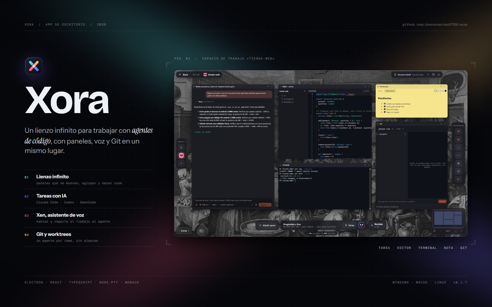

> Working name. An infinite, zoomable canvas for working with AI coding agents.

Xora is a desktop app (Electron + React) where every project folder becomes a **workspace**: a canvas on which you place, move and resize panels — agents, terminals, an editor, a browser, sticky notes and Git — and talk to all of them by voice.

It works with the coding agents you already have installed and signed in to: **Claude Code**, **Codex** and **OpenCode**. Everything runs locally; Xora has no servers of its own.

## Download

**[⬇ Download the latest version](https://github.com/Jhonnyxavier2729/xora/releases/latest)**: no Node.js, no `npm install`. Download, run, done.

| System | File | How to install |
| --- | --- | --- |
| **Windows 10/11** | `Xora-Setup-x.y.z.exe` | Run it and follow the installer. |
| **macOS** (Apple Silicon / Intel) | `Xora-x.y.z-mac-arm64.dmg` / `-x64.dmg` | Open it and drag Xora to Applications. |
| **Linux** | `Xora-x.y.z-linux-x64.AppImage` or `.deb` | AppImage: make it executable and run it. `.deb`: install it with your package manager. |

Xora updates itself: new versions download in the background and install when you close the app (Windows and Linux).

> **First launch.** The app is not code-signed yet, so the system may warn you:
> - **Windows** (SmartScreen): click **More info → Run anyway**.
> - **macOS**: right-click Xora in Applications → **Open** → **Open** (only the first time).

## Features

### Canvas
- Infinite canvas with zoom (Ctrl + wheel), panning (drag the background, middle mouse or Space + drag), minimap, auto-layout (Ctrl+Shift+L), fit-to-view (Ctrl+Shift+1) and multi-select (Ctrl+A).
- Floating UI: workspace switcher (Ctrl+1…9), tools rail, bottom dock, inbox of agents waiting for you.
- Right-click menu with a filter: new task, terminal, editor, browser, note, panel library, paste a URL (opens a browser) or text (creates a note), change look.
- Themes (9), accent colors and 50 public-domain wallpapers, or your own image.
- **Extras**: your latest notes, a focus timer (pomodoro) and focus music (lofi and ambient playlists).
- **Usage left**: a meter under the dock with the session and weekly limits left on your Claude Code and Codex plans.

### Panels
| Panel | What it does |
| --- | --- |
| **New task** | A structured session with Claude Code, Codex or OpenCode: model picker (lists each CLI's real models), Build/Plan mode, four access levels (Supervised, Auto-accept edits, Auto, Full access), file attachments, slash commands, dictation, live streaming, tool calls and Allow/Deny approval cards. |
| **Agent** | Any agent CLI in a real terminal, with automatic *working / waiting for you / needs approval* detection and notifications. |
| **Terminal** | A real shell (PowerShell 7 if installed) via ConPTY. |
| **Editor** | Monaco (VS Code's editor) with a file tree. |
| **Browser** | An isolated browser for `localhost` or any site. |
| **Notes** | Markdown sticky notes in five colors. |
| **Git** | Status, diff, commit, **comments on diff lines sent to an agent**, and isolated tasks in **worktrees** (one agent per branch). |

### Xen, the voice companion
- Hold a key (Right Ctrl by default), speak, release. The screen edges glow while Xen listens. If your cursor is in a text box, what you say is typed there instead.
- Xen understands what you said and routes it to the right agent ("tell Claude to add tests to the login").
- Xen is powered by **your own agents** — Claude Code, Codex or OpenCode, in the priority order you choose, with automatic fallback — so it needs no API key. The Anthropic API is optional.
- **Dictate** types what you say wherever your cursor is.
- Speech-to-text uses Whisper via Groq (free tier) or OpenAI with your own key.
- Xen can read its replies aloud with your system voice (free) or a natural OpenAI voice, with a choice of voices and speed.

### Remote access
Open your terminals and agents from your phone, answer agents that are waiting for you and talk to Xen. Devices pair once with a one-time QR code; an optional Cloudflare tunnel provides HTTPS outside your home network.

### Accounts
Xora detects the sign-in of each agent CLI and can open its login command for you. If you prefer, each agent can use your own API key instead (stored encrypted).

## Requirements

- At least one coding agent installed and signed in (Xora finds them automatically):
  - [Claude Code](https://docs.anthropic.com/en/docs/claude-code)
  - [Codex](https://github.com/openai/codex)
  - [OpenCode](https://opencode.ai)
- For voice: a free [Groq API key](https://console.groq.com/keys) (or an OpenAI key), added in **Settings → API keys**.
- Optional: `gh` (GitHub CLI) to clone your repositories from the app, and `cloudflared` for the remote-access tunnel.

## Building from source

Only needed if you want to change Xora's code. Requires Node.js 22+.

```bash
npm install
npm run dev
```

Build an installer into `dist/`:

```bash
npm run dist:win     # Windows (.exe)
npm run dist:mac     # macOS (.dmg), on a Mac
npm run dist:linux   # Linux (.AppImage, .deb), on Linux
```

Releases are built automatically for all three systems by GitHub Actions when a version tag (`v*`) is pushed.

## Architecture

```
src/
  main/         Electron main process
    tasks.ts      "New task" drivers: Claude Code (stream-json + approvals), Codex (exec --json), OpenCode (run --format json)
    xen.ts        Xen: routes voice/text requests through Claude Code, Codex, OpenCode or the Anthropic API
    pty.ts        terminals (node-pty) and agent status detection
    voice.ts      push-to-talk (uiohook), floating pill, Whisper transcription
    tts.ts        natural voice for Xen's replies (OpenAI)
    usage.ts      plan limits left for Claude Code and Codex
    updater.ts    automatic updates from GitHub Releases
    remote.ts     HTTP + WebSocket server for remote access, pairing and tunnel
    accounts.ts   agent sign-in detection and per-agent API keys
    workspaces.ts recent projects, cloning, blank canvases, import/export
    git.ts        status, diff, commit and worktrees (simple-git)
    files.ts      file access restricted to open workspaces
    store.ts      persistence and encrypted secrets (safeStorage)
    redact.ts     hides secrets in any error shown or sent
  preload/      minimal API exposed through contextBridge
  renderer/     React UI: canvas, panels, settings, voice pill and the mobile remote client
  shared/       shared types
```

## Security

See [SECURITY.md](SECURITY.md) for the security model: isolated renderer, validated IPC, restricted file access, encrypted secrets, hashed device tokens and secret redaction.

## Credits

- Logo and icons: original (`build/icon.svg`; `node build/make-icons.mjs` regenerates the PNG/ICO).
- Wallpapers: works from the Birmingham Museums Trust collection, public domain (CC0). See `src/renderer/public/wallpapers/CREDITS.md`.

## License

[MIT](LICENSE)
